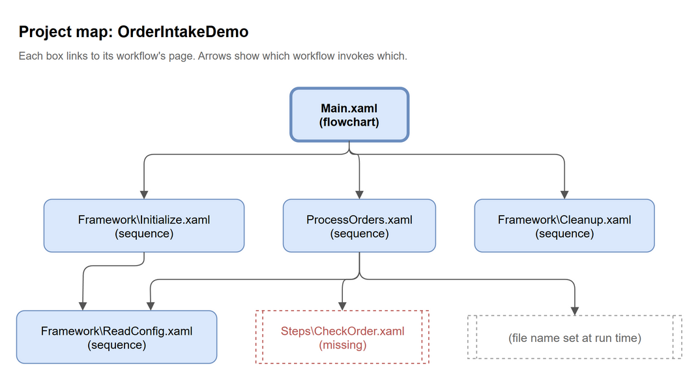

# uipath-to-drawio

Turn UiPath workflow files (`.xaml`) into editable [draw.io](https://www.drawio.com) diagrams.

[](LICENSE)


See how a project's workflows invoke one another, review its state machines and flowcharts, and document an automation for review or migration planning, without opening UiPath Studio. The converter runs entirely offline in PowerShell on Windows, with no extra modules, and reports what it drew, summarised or could not read.

**This is a structural overview, not a complete picture of runtime behaviour.** State machines and flowcharts are drawn. Sequences are drawn step by step, with their If, Else If and Switch branches, Try/Catch regions and loops; application and browser scopes are not yet expanded, and other top-level workflow types receive summary pages. The tool does not execute workflows or migrate their implementation to another platform.

> Sequence pages, with their branches, Try/Catch regions and loops, were added in release 0.2.0. Release 0.1.0 gives sequences a summary page. See the [changelog](CHANGELOG.md).

[Quick start](#quick-start) | [Supported content](#supported-content) | [Options](#options) | [Detailed usage guide](docs/usage.md)

## What you get

- **Editable diagrams:** native `.drawio` shapes and connectors that you can annotate or export in draw.io. Supported diagrams use Studio's saved layout when available, otherwise an automatic layout.
- **A project map:** see which workflow invokes which, with links to workflow pages inside the generated file. Large projects are wrapped onto several rows to keep the map readable.
- **A conversion report:** identify summary-only workflows, missing references, activities from custom or third-party packages, and read or write failures before relying on the diagrams.

## Supported content

Support depends on the workflow's **top-level activity**, not just its `.xaml` extension.

| Content | Current output |
| --- | --- |
| Top-level state machine | States, named transitions, start marker and invoked workflows. Activities inside each state are not expanded. |
| Top-level flowchart | Steps, decisions, switches and their connections. Container activities are summarised rather than expanded. |
| Project workflow calls | A map of `InvokeWorkflowFile` references. Missing, external and runtime-computed targets are marked rather than guessed. |
| Top-level sequence | Its activities top to bottom, in the order written, with nested sequences as frames and invoke steps linked to their workflows. If, Else If and Switch are decisions with their labelled branches; an empty branch is shown going straight on. Try/Catch shows its Try, Catch and Finally regions; loops and Retry Scope show their body. Activities that end the path (Break, Continue, Throw) say so. Any other activity that holds others (application and browser scopes, for example) is one dashed box saying how many activities it holds and listing the workflows invoked inside it; its contents are not expanded yet. |
| Top-level If, Try/Catch, loops and other activities | A summary listing the workflows they invoke, not a step-by-step diagram. |
| Nested flowcharts or state machines | Not expanded into their own diagrams. |
| Flowchart and sequence steps using activities from custom or third-party packages | Plain dashed boxes showing the activity type; the report lists each such type with its package. |
| Coded workflows (`.cs`), Invoke Process and Run Parallel Process | Coded workflows are not converted; these other process-starting activities do not create project-map links. |

In sequence-heavy projects some logic still sits inside application and browser scopes, which are not expanded yet. The report says, for each workflow, how many of its activities are drawn. See the [usage guide](docs/usage.md) for how each case is represented.

## Example output

These diagrams come from the repository's [made-up samples](samples/README.md), not real business workflows.

| Project map | State machine |
| --- | --- |
| [](docs/images/project-map.png) | [](docs/images/state-machine.png) |
| Follow calls between files and open their linked pages in draw.io. | Review state transitions and the workflows invoked by each state. |

Open either image for a larger view, or see the [flowchart example](docs/images/flowchart.png).

## Requirements and compatibility

- **To convert:** Windows with Windows PowerShell 5.1 (included in Windows 10 and 11) or PowerShell 7. No UiPath installation, credentials or extra runtime dependencies are needed.
- **To view and edit:** the [draw.io desktop app](https://www.drawio.com), [app.diagrams.net](https://app.diagrams.net), or Visual Studio Code with the [Draw.io Integration extension](https://marketplace.visualstudio.com/items?itemName=hediet.vscode-drawio).

**UiPath compatibility:** automated tests cover made-up XAML workflows and both saved-layout formats. A [compatibility run](docs/compatibility-report.md) over 93 public projects, from Studio 2018 to 2026, converted every project in both PowerShell versions. With release 0.2.0, 642 of the 657 workflows have step-by-step pages, but coverage is partial: 42.7% of activities are drawn individually and 350 workflows have every activity drawn. The [compatibility report](docs/compatibility-report.md) gives the figures for each release. No cross-platform projects were available to test. Try a representative project and check the report before relying on the output. The converter itself is Windows-only.

## Quick start

### 1. Get the tool

Download `uipath-to-drawio-<version>.zip` from the [latest release](https://github.com/sgshaji/uipath-to-drawio/releases/latest), extract it, and open PowerShell in the extracted folder. The release lists the file's SHA-256 checksum; to compare your download with it:

```powershell
(Get-FileHash .\uipath-to-drawio-0.2.0.zip -Algorithm SHA256).Hash
```

You can also download the current repository using **Code > Download ZIP**, or, with Git installed:

```powershell
git clone https://github.com/sgshaji/uipath-to-drawio.git
Set-Location .\uipath-to-drawio
```

If Windows blocks the downloaded script, review it and remove its download block:

```powershell
Unblock-File -LiteralPath .\src\Convert-UiPathToDrawio.ps1
```

Unblocking does not override your organisation's execution policy. See [troubleshooting](docs/usage.md#troubleshooting) if scripts are still blocked.

### 2. Convert the bundled sample

Run this from the repository folder:

```powershell
.\src\Convert-UiPathToDrawio.ps1 -Path .\samples\project -OutputPath .\output\demo
```

It creates:

```text
output\demo\OrderIntakeDemo.drawio
output\demo\OrderIntakeDemo.conversion-report.txt
```

The diagram has a project map and five workflow pages: a flowchart and four sequences, one of them with a For Each loop. The sample deliberately includes a missing workflow, a runtime-computed file name and an activity from a made-up third-party package, so you can see how incomplete information is reported.

### 3. Open the diagram and review the report

Open the `.drawio` file in the desktop app, or use **File > Open from > Device** at app.diagrams.net for this made-up sample. The first page is the project map; its workflow boxes link to the other pages. The [diagram legend](docs/usage.md#diagram-legend) explains the shapes.

Open the `.conversion-report.txt` file in a text editor. Check **Workflows converted**, **Not drawn in version 1**, missing references and read failures. A generated page does not mean every activity was drawn.

## Convert your own workflows

From the repository folder, replace these example paths with your own. For a project, use its root folder, normally the folder containing `project.json`:

```powershell
.\src\Convert-UiPathToDrawio.ps1 -Path "C:\Workflows\MyProcess" -OutputPath "C:\Diagrams\MyProcess"
```

For just one workflow:

```powershell
.\src\Convert-UiPathToDrawio.ps1 -Path "C:\Workflows\MyProcess\Main.xaml" -OutputPath "C:\Diagrams\Main"
```

Single-file conversion does not convert the workflows it invokes. Use project-folder conversion for linked pages and the project map.

## Options

| Parameter | Meaning |
| --- | --- |
| `-Path` | Required. A project folder or a single `.xaml` file. |
| `-OutputPath` | Output folder; created if needed. If omitted, outputs go beside the input file or beside the project folder, not inside it. |
| `-OnePerFile` | Separate `.drawio` files for each workflow and the project map. Links between workflow pages are lost because they only work within one file. |
| `-IncludeDetails` | Add transition and decision conditions, switch expressions, runtime-computed file names and full paths of invoked files outside the project. Review the output before sharing it. |
| `-PassThru` | Return an object with written diagram paths, report path, workflow count, warnings, skipped folders and diagram write failures for scripting. |

For built-in help:

```powershell
Get-Help .\src\Convert-UiPathToDrawio.ps1 -Full
```

## Understanding the results

A project normally produces `<project>.drawio` and `<project>.conversion-report.txt`; a single file produces `<file>.drawio` and `<file>.conversion-report.txt`. See [output files](docs/usage.md#output-files) for naming and split-file output.

- **Exit code 0 means the outputs were written, not that conversion was complete.** Summary-only pages, unreadable workflows and unresolved references can still be present. Always inspect the [conversion report](docs/usage.md#conversion-report), including when using `-PassThru`.
- **Exit code 1 means the tool could not start or could not write an output.** Some files may already have been written; check the error and any report produced.
- **Existing outputs with the same names are replaced.** Regeneration does not merge your draw.io edits. Keep an annotated copy separately.

## Privacy and security

- Conversion runs locally. The tool reads XAML as data, does not execute it, does not upload its contents, and writes only to the output folder.
- Invoked paths outside the project, including network shares, are not looked up.
- By default, conditions, expressions, runtime-computed file names and full outside-project invoke paths are omitted. `-IncludeDetails` includes them.

**Omitting details is not anonymisation.** Workflow names, project-relative paths, activity display names and other labels remain in diagrams and reports, and those names can themselves contain sensitive information. Review both outputs before sharing, even without `-IncludeDetails`.

For confidential workflows, use the offline draw.io desktop app and follow your organisation's handling rules rather than loading the files into a website.

## Help and contributing

- [Usage guide](docs/usage.md): scanning rules, diagram details, workflow links, reports and the shape legend.
- [Troubleshooting](docs/usage.md#troubleshooting): blocked scripts, missing files, summary pages and opening diagrams.
- [Samples](samples/README.md): small, hand-written workflows you can try and extend.
- [Project context](CONTEXT.md): design decisions and XAML format notes.

When reporting a problem, provide a small made-up reproducer, your PowerShell version and a reviewed, redacted report. Do not attach real business workflows or unreviewed diagrams.

The converter and its helpers live in [one script](src/Convert-UiPathToDrawio.ps1). Tests use only made-up workflows and require no extra packages. Run them from the repository folder:

```powershell
pwsh -File .\tests\Test-Converter.ps1                                  # PowerShell 7
powershell -ExecutionPolicy Bypass -File .\tests\Test-Converter.ps1   # Windows PowerShell 5.1
```

To validate an individual output, see [checking a generated file](docs/usage.md#checking-a-generated-file). Structural checks do not replace opening the diagram in draw.io.

## License

[MIT](LICENSE).

UiPath is a trademark of UiPath Inc. This project is independent and is not affiliated with, endorsed by or sponsored by UiPath.
