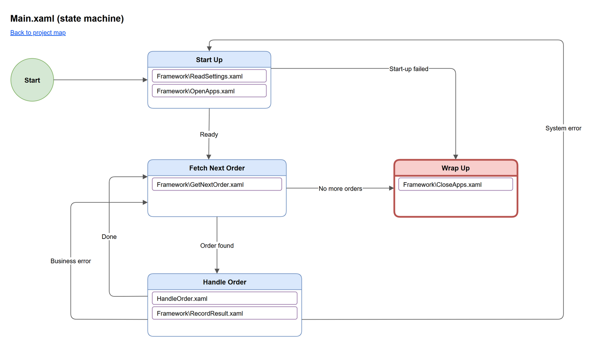
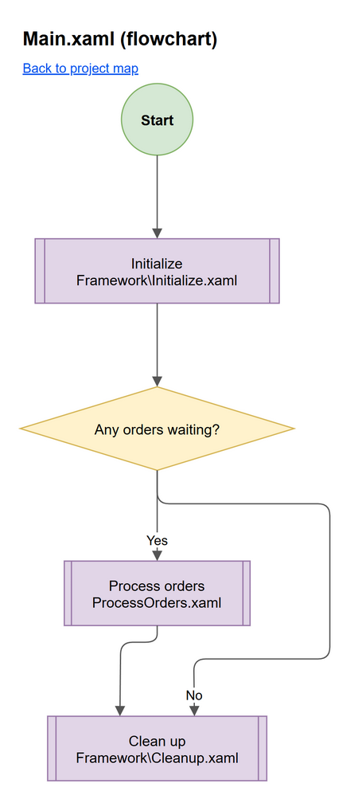

# uipath-to-drawio

Turn UiPath workflows into editable [draw.io](https://www.drawio.com) diagrams.

[](LICENSE)




`uipath-to-drawio` reads UiPath Studio workflow files (`.xaml`) and writes diagrams you can open, edit and share in draw.io. State machines and flowcharts keep the layout you see in Studio. Convert a whole project and you also get a map of which workflow invokes which, with every page linked.

It is a single PowerShell script with no dependencies. It reads your files as data, never runs anything from them, and works entirely offline.

## Contents

- [Features](#features)
- [Requirements](#requirements)
- [Installation](#installation)
- [Usage](#usage)
- [Output](#output)
- [What is drawn](#what-is-drawn)
- [Limitations](#limitations)
- [Privacy and security](#privacy-and-security)
- [Troubleshooting](#troubleshooting)
- [Running the tests](#running-the-tests)
- [License](#license)

## Features

- **State machines:** states, transitions with their names, final states, and the workflows each state invokes.
- **Flowcharts:** steps, decisions and switches, with the branch labels set in Studio (for example Yes and No).
- **Project map:** one page showing which workflow invokes which, linked to a page for every workflow.
- **Studio's layout:** positions saved by Studio are kept. Workflows without a saved layout are laid out automatically, with no arrow crossing a box.
- **Conversion report:** lists invoked files that are missing, file names set at run time, unrecognised activities and broken links.
- **Safe by default:** conditions, expressions and server paths stay out of the diagram unless you ask for them.

## Requirements

- Windows, with Windows PowerShell 5.1 (built into Windows 10 and 11) or PowerShell 7.
- A way to open `.drawio` files: the [draw.io desktop app](https://www.drawio.com), [app.diagrams.net](https://app.diagrams.net) in a browser, or Visual Studio Code with the [Draw.io Integration](https://marketplace.visualstudio.com/items?itemName=hediet.vscode-drawio) extension.

## Installation

Download the repository: on GitHub, select **Code > Download ZIP** and unzip it, for example to `C:\Tools\uipath-to-drawio`. Or clone it:

```powershell
git clone https://github.com/sgshaji/uipath-to-drawio.git C:\Tools\uipath-to-drawio
```

Windows marks files downloaded in a ZIP as coming from the internet, and may then refuse to run the script. Unblock them once:

```powershell
Get-ChildItem C:\Tools\uipath-to-drawio -Recurse | Unblock-File
```

There is nothing else to install.

## Usage

Open PowerShell and run the script with the folder or file to convert (`-Path`) and the folder for the results (`-OutputPath`).

**Convert a project** (recommended). Point `-Path` at the project folder, the one that contains `project.json`:

```powershell
C:\Tools\uipath-to-drawio\src\Convert-UiPathToDrawio.ps1 -Path "C:\UiPath\MyProcess" -OutputPath "C:\Diagrams"
```

**Convert a single workflow:**

```powershell
C:\Tools\uipath-to-drawio\src\Convert-UiPathToDrawio.ps1 -Path "C:\UiPath\MyProcess\Main.xaml" -OutputPath "C:\Diagrams"
```

**Try it on the included sample** without any files of your own:

```powershell
cd C:\Tools\uipath-to-drawio
.\src\Convert-UiPathToDrawio.ps1 -Path ".\samples\state-machine" -OutputPath "$env:TEMP\uipath-to-drawio-demo"
```

The script prints the files it wrote. Open the `.drawio` file in draw.io.

Tips:

- Put quotes around any path that contains spaces.
- To get the exact path of a file or folder, right-click it in File Explorer and select **Copy as path**.
- A path starting with `.\` is relative to the folder PowerShell is in. Full paths, as in the examples above, work from any folder.

### Options

| Parameter | Description |
| --- | --- |
| `-Path` | Required. The project folder or `.xaml` file to convert. |
| `-OutputPath` | The folder to write the results to. It is created if it does not exist. Defaults to the folder that contains the input. |
| `-OnePerFile` | Write a separate `.drawio` file for each workflow, plus one for the project map, instead of a single file with a page per workflow. Links between pages are only possible within a single file. |
| `-IncludeDetails` | Also show transition and decision conditions, switch expressions, file names worked out at run time, and the full path of invoked files outside the project. These can contain server names and data, so they are left out by default. |

For the full help, run `Get-Help C:\Tools\uipath-to-drawio\src\Convert-UiPathToDrawio.ps1 -Full`.

## Output

Converting a project folder produces two files in the output folder, named after the project in `project.json` (or after the folder, if there is no name there):

| File | Contents |
| --- | --- |
| `<project>.drawio` | A **Project map** page first, then one page per workflow. Select a box on the map to open that workflow's page; each workflow page links back to the map. |
| `<project>.conversion-report.txt` | What was converted, and anything that could not be drawn or found. |

Converting a single `.xaml` file produces `<file>.drawio` with one page, and `<file>.conversion-report.txt`. The workflows it invokes are listed but not linked, because they are not converted.

The project map of the `samples/project` sample, which includes a missing file and a file name set at run time:


## What is drawn

| In UiPath | In the diagram |
| --- | --- |
| State | Rounded box listing the workflows it invokes. Final states have a thick red border. |
| Transition | Arrow labelled with the transition's name. |
| Flowchart step | Box with the step's name. |
| Invoke Workflow File | Purple box naming the invoked file, linked to its page. |
| Flow decision | Diamond. Branches carry the labels set in Studio, or True and False. |
| Flow switch | Diamond. Branches carry the case names and Default. |
| Sequence, and any other kind of workflow | A summary card listing the workflows it invokes. |
| Activity the converter does not recognise | Dashed grey box showing the activity type. |
| Invoked file that does not exist | Dashed red box marked "missing". |
| Invoked file outside the project folder | Dashed grey box marked "outside the project". |

A flowchart laid out automatically, with the decision's Yes and No branches:



## Limitations

- Sequences, If, Try/Catch and loops are not yet drawn step by step. Their pages list the workflows they invoke.
- The activities inside a state are not drawn; each state lists the workflows it invokes.
- Only Invoke Workflow File is followed. Other ways of starting work, such as Invoke Process, Run Parallel Process or coded workflows (`.cs`), do not appear on the project map.
- Windows only.

## Privacy and security

- The converter only reads the input and only writes to the output folder.
- Workflow files are treated as data. Nothing in them is run or evaluated.
- It works offline and sends nothing anywhere. Invoked file paths that lead outside the project, such as network shares, are never looked up.
- By default, conditions, expressions and paths outside the project are left out of the diagram.
- The conversion report gives file names, not full paths, so it does not reveal your user name or folder structure.

## Troubleshooting

| Problem | Solution |
| --- | --- |
| "...cannot be loaded because running scripts is disabled on this system", or "...is not digitally signed" | Unblock the files (see [Installation](#installation)), or run: `powershell -ExecutionPolicy Bypass -File C:\Tools\uipath-to-drawio\src\Convert-UiPathToDrawio.ps1 -Path "..." -OutputPath "..."` |
| "The term '.\src\Convert-UiPathToDrawio.ps1' is not recognized" | PowerShell is not in the converter's folder. Use the script's full path, or run `cd C:\Tools\uipath-to-drawio` first. |
| "Path not found: ..." | The `-Path` does not exist. Use **Copy as path** in File Explorer to get it exactly. |
| "Could not write 1 diagram file(s)..." | A `.drawio` file was open in another program or read-only. Close it and run again. The report names the file. |
| The `.drawio` file opens as XML text in Visual Studio Code | Install the Draw.io Integration extension. |

The script exits with code 0 when everything was written, and 1 if anything could not be.

## Running the tests

The tests use only the made-up workflows in [`samples`](samples) and [`tests/fixtures`](tests/fixtures), and need nothing installed:

```powershell
pwsh -File .\tests\Test-Converter.ps1                                  # PowerShell 7
powershell -ExecutionPolicy Bypass -File .\tests\Test-Converter.ps1   # Windows PowerShell 5.1
```

To check that a diagram you generated is well-formed:

```powershell
pwsh -File .\tests\Test-Converter.ps1 -CheckFile "C:\Diagrams\MyProcess.drawio"
```

## License

Released under the [MIT License](LICENSE).

UiPath is a trademark of UiPath Inc. This project is independent and is not affiliated with, endorsed by or sponsored by UiPath.
